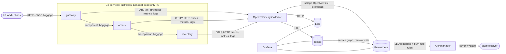

# Lighthouse: SLO-driven observability

[](https://github.com/ahmedelgmal310/sre-observability-slo/actions/workflows/ci.yml)
[](LICENSE)

Three Go microservices with full OpenTelemetry instrumentation, a
Prometheus/Tempo/Loki/Grafana stack, SLOs written as code, and burn-rate alerts
that CI **proves** work: every push runs real load, injects real faults, and
fails unless the paging alert fires and reaches Alertmanager.

## Architecture



| Signal | How it is produced | Where it goes | Linked to |
|---|---|---|---|
| Traces | Server and client spans per hop, W3C context propagation | Collector -> Tempo | logs (trace_id), metrics (service map) |
| Metrics | `http.server.request.duration` histogram (RED) with trace-based exemplars | Collector -> Prometheus | traces (exemplars) |
| Logs | `slog` JSON on stdout + OTel log bridge, `trace_id`/`span_id` on every line | Collector -> Loki (native OTLP) | traces (derived field) |

In Grafana you can click an exemplar on a latency graph to open that exact
request's trace, jump from any span to its log lines, and from a log line back
to the trace.

## SLOs

| SLO | Objective (30 days) | Fast burn page | Slow burn page |
|---|---|---|---|
| Gateway availability (non-5xx) | 99.5% | 1h **and** 5m error ratio > 7.2% (14.4x) | 6h **and** 30m > 3% (6x) |
| Gateway latency (< 300 ms) | 95% | 1h **and** 5m slow ratio > 72% (14.4x) | 6h **and** 30m > 30% (6x) |

Multi-window, multi-burn-rate alerting from the Google SRE Workbook. Recording
rules, error budget and burn-rate series live in
[`observability/prometheus/rules/slo-gateway.yml`](observability/prometheus/rules/slo-gateway.yml),
unit-tested with `promtool test rules` in
[`observability/prometheus/tests`](observability/prometheus/tests/slo-gateway.test.yml).
Each alert links to a runbook in [`docs/runbooks`](docs/runbooks). The reasoning
is written up in [`docs/slo.md`](docs/slo.md).

## Results (from CI)

Numbers from [CI run 40447873001](https://github.com/ahmedelgmal310/sre-observability-slo/actions/runs/40447873001)
(commit `90bb1a1`) on a standard GitHub-hosted `ubuntu-24.04` runner. Every
run publishes the same table in its job summary and uploads `results.json` as an
artifact.

**Baseline**: 2 minutes, 15 journeys/s (create + read order), 30 req/s at the gateway.

| Metric | Result | SLO |
|---|---|---|
| Requests | 3,600, 0 failed (0.000%) | < 0.5% errors |
| Client latency p50 / p95 / p99 (k6) | 28.7 / 56.7 / 75.1 ms | p95 < 300 ms |
| Server latency p95 / p99 (gateway histogram) | 62.4 / 74.6 ms | |
| Gateway requests slower than 300 ms | 0% | < 5% |
| SLO alerts firing | none | |
| Log lines ingested (10 min) | 12,464 | |

**Correlation checks** (all asserted, not eyeballed): an exemplar on the gateway
histogram carried trace `bbefe63f...`; Tempo returned that trace with spans from
gateway, orders and inventory; Loki returned inventory log lines with the same
`trace_id`; the Tempo service graph produced 3 edges; Grafana reported all three
datasources healthy and both dashboards provisioned.

**Chaos**: k6 sends `baggage: chaos.target=inventory,chaos.error_rate=0.3`; the
fault fires two hops behind the gateway and surfaces as 502s at the edge.

| Metric | Result |
|---|---|
| `GatewayAvailabilityFastBurn` pending | after 60 s |
| `GatewayAvailabilityFastBurn` firing | **after 120 s** of injected faults |
| Gateway 5xx ratio (5m window) at fire time | 13.3% |
| 1h burn rate at fire time | 26.6x (threshold 14.4x) |
| Delivered to Alertmanager | yes, `page` receiver |

The 120 s is mostly by design: about 60 s for the error ratio to cross the
threshold through the export (5 s), scrape (5 s) and rule evaluation (15 s)
pipeline, plus the `for: 1m` debounce on the alert.

## Run it locally

Requires Docker with Compose v2.

```sh
docker compose up -d --build --wait
open http://localhost:3000                      # Grafana (anonymous viewer)

# steady load, thresholds = SLOs
docker compose run --rm k6 run /scripts/baseline.js

# break inventory for 30% of requests and watch the SLO dashboard burn
docker compose run --rm -e CHAOS_ERROR_RATE=0.3 k6 run /scripts/chaos.js

# or inject by hand
curl -X POST localhost:8080/api/orders -H 'Content-Type: application/json' \
  -H 'baggage: chaos.target=inventory,chaos.error_rate=1' -d '{"sku":"sku-1","qty":1}'

docker compose down -v
```

| URL | What |
|---|---|
| http://localhost:3000/d/lighthouse-slo | SLO dashboard: SLIs, error budget, burn rates, alert timeline |
| http://localhost:3000/d/lighthouse-red | RED dashboard: rate/errors/latency with exemplars, service map, logs |
| http://localhost:9090/alerts | Prometheus alerts |
| http://localhost:9093 | Alertmanager |

Fault injection: `CHAOS_ERROR_RATE` / `CHAOS_LATENCY_MS` apply a fixed fault to
one service; with `CHAOS_ENABLED=true`, the baggage keys `chaos.target`
(service name, `a|b` list or `*`), `chaos.error_rate` and `chaos.latency_ms`
apply per request. Baggage-driven faults are off unless explicitly enabled.

## CI

[`.github/workflows/ci.yml`](.github/workflows/ci.yml), all jobs on every push and PR:

| Job | What it checks |
|---|---|
| Go | `go vet`, `go test -race`, coverage gate (>= 80%, currently 96.0%), `govulncheck` |
| golangci-lint | v2 config with gosec, errorlint, revive, bodyclose, noctx and others |
| Config validation | `promtool check config/rules` + `promtool test rules`, `amtool check-config`, `otelcol validate`, dashboard JSON, `docker compose config`, hadolint, shellcheck, actionlint |
| Gitleaks | full git history, SARIF to code scanning |
| End-to-end | builds images, starts the stack, k6 baseline against SLO thresholds, verifies metrics/exemplars/traces/logs/dashboards, runs chaos and asserts the fast-burn alert fires and pages |

Every action is pinned to a full commit SHA, every image to a digest, and the
workflow runs with `contents: read` (Gitleaks adds `security-events: write`).
See [`docs/versions.md`](docs/versions.md).

## Repository layout

```
cmd/{gateway,orders,inventory}   service entry points
internal/
  app/        process lifecycle: config, health, graceful shutdown, -healthcheck
  telemetry/  OTel SDK setup (traces, metrics + exemplars, logs)
  httpx/      server instrumentation (spans, RED histogram, access logs), propagating client
  logging/    slog JSON + OTel bridge with trace_id/span_id
  chaos/      error/latency injection from env or W3C baggage
  gateway/ orders/ inventory/   business handlers
observability/
  otel-collector/  prometheus/ (config, rules, tests)  alertmanager/  tempo/  loki/
  grafana/  provisioning (datasources with cross-links) and dashboards as JSON
loadtest/   k6 baseline and chaos scripts
scripts/    end-to-end assertions used by CI
docs/       SLO rationale, runbooks, pinned versions
```

## Design notes

- **SLIs come from the server-side histogram, not from k6.** k6 thresholds are a
  second, client-side opinion. The `0.3` s bucket boundary is explicit so the
  latency SLI is exact.
- **Faults travel as W3C baggage.** The chaos header is set once at the edge and
  OpenTelemetry carries it to every hop, so a test can break a service it cannot
  reach directly, exactly like a real downstream failure.
- **Hardened containers.** Services run as `nonroot` on distroless with a
  read-only root filesystem, all capabilities dropped and `no-new-privileges`;
  the health probe is the service binary itself (`-healthcheck`), so the image
  needs no shell or curl. Ports bind to `127.0.0.1` only.
- **No runtime downloads.** Grafana plugin preinstall is disabled so the
  datasource plugins bundled in the pinned image are used as-is.

## License

[MIT](LICENSE)
